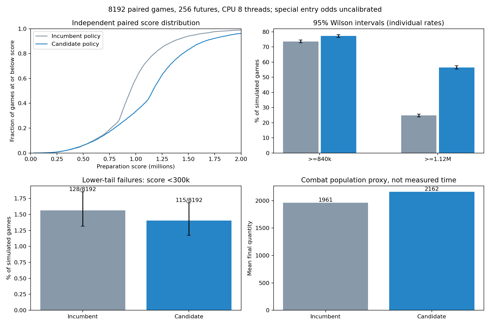
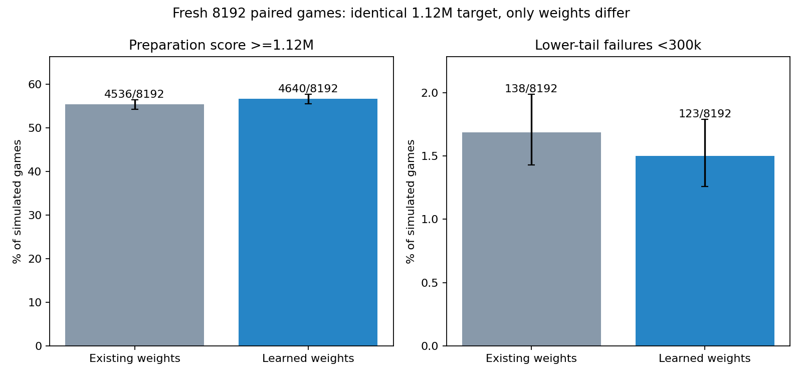
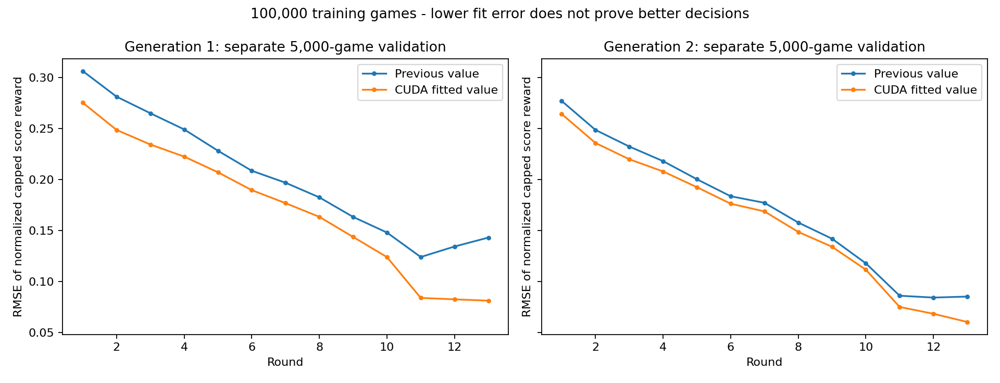

# 블러드 러스트 GPU 학습 및 독립 평가 결과

이번 작업에서 독립 학습 200,000판, 검증 20,000판으로 두 목적함수와 각 두 세대를 시험했다.
GPU는 RTX 4060 Laptop이다. 배포 기본 모델은 교체하지 않았다. 아래 수치는 동일한 감사용
시뮬레이터의 정책 비교이며 실제 전리품 확률이 아니다.

동일 목표의 새 8,192쌍 확증: 같은 목표에서도 후보의 달성률 개선을 확인했다.
기존 4536/8192, 후보 4640/8192,
차이 +1.27%포인트, 95% 대응 구간 [+0.04, +2.51].

**준비 점수 개선 후보를 찾았지만 배포 기준을 모두 해결한 것은 아니다.**
아래 전체 정책 비교에서 30만 미만 감소는 통계적으로 확실하지 않았고,
성수 계열에서는 저점 악화가 관측됐다. 이 전체 정책 비교의 CPU 완주 경과시간은 +30.9%,
최종 몬스터 수량은 +10.3% 변했다. 같은 목표의 가중치 비교 결과는 별도 표에 구분한다.
따라서 저점 안정성이나 전투시간까지 개선한 최적 모델로 부르지 않는다.

## 목적함수와 최종 결과

달성/미달만 보상한 첫 실험은 512판 선별에서 30만 미만이 7회에서 132/139회로 늘어 기각했다.
첫 실험의 예정된 8,192판 검증은 완료하지 않았다. 실패한 결과와 원인을 보존했다.

두 번째 실험은 목표까지의 점수를 연속적으로 보상한다. 512판 선별의 저점/CPU 조건을
통과한 `g1`를 고정하고, 학습이나 선택에 쓰지 않은 동일 시드 8,192개를
각 정책으로 완주했다. 256 futures, CPU 8스레드, 포션/도구 리롤 3/1 조건이다.
기존 가중치의 목표는 840k, 후보의 목표는 1.12M이므로 전체 정책을 비교하는 주 평가다.

| 지표 | 기존 정책 | 새 후보 |
|---|---:|---:|
| 준비 점수 1.12M 이상 | 2030/8192 (24.78%) | 4627/8192 (56.48%) |
| 준비 점수 840k 이상 | 6033/8192 | 6330/8192 |
| 300k 미만 | 128/8192 | 115/8192 |
| 하위 10% 점수 | 595,323 | 607,362 |
| 평균 점수 | 979,097 | 1,158,625 |
| 평균 최종 몬스터 수량 | 1,960.8 | 2,162.2 |
| 평균 사용 탱크 수 | 3.83 | 3.93 |
| 전체 완주 경과시간(초) | 3782.7 | 4949.7 |

주 지표의 대응 차이는 +31.70%포인트, paired bootstrap 95% 구간
[+30.40, +33.01]%포인트, exact McNemar p=<1e-300 (floating-point underflow)이다.
새로 목표를 넘긴 판 3171개, 기존에는 넘겼으나 후보에서 못 넘긴 판 574개다.
30만 미만 비율의 차이는 -0.16%포인트,
대응 bootstrap 95% 구간 [-0.50, +0.18],
exact p=0.395016다. 이 지표는 음수일수록 좋다.
주 지표 이외의 검정은 탐색적 진단이며 다중 검정을 보정한 확증 결과가 아니다.
하위 10% 점수의 상승만으로 저점 전체의 비열등성을 주장하지 않는다.
기존 840k 전용 native gate: `pass`.
CPU 완주 시간은 OCR/화면 지연 측정이 아니다. 일부 빌드/검증 작업이 병행되었으므로
경과시간 비율을 정밀한 단독 처리량 측정으로 보지 않는다.

목표 변경과 가중치 변경을 분리한 추가 1,024판도 같은 1.12M 목표에서 비교했다.
학습에 쓰지 않은 주 평가 시드의 앞 1,024개를 사용했고, 후보를 다시 고르지 않았다.
기존 가중치 570/1024, 후보 595/1024,
차이 +2.44%포인트, paired exact p=0.174825.
이는 별도로 선언한 부가 진단이며 주 검정으로 바꿔 부르지 않는다.

## 새 시드에서 같은 목표로 검증한 가중치 효과

위 1,024판은 신뢰구간이 0을 포함했다. 그 결과를 보고 같은 표본을 늘리지 않고,
새 시드 1,270,000,000부터 8,192개를 고정해 두 정책 모두 `--goal target --target-score 1120000`으로
다시 비교했다. 후보 가중치와 엔진은 그대로 고정했고 추가 학습/재선별을 하지 않았다.
가정 q=.4, 차이 2%포인트, 양측 유의수준 .05에서 계획 검정력은 약 81.2%다.

| 동일 목표 지표 | 기존 가중치 | 학습 가중치 |
|---|---:|---:|
| 1.12M 이상 | 4536/8192 (55.37%) | 4640/8192 (56.64%) |
| 840k 이상 | 6247/8192 | 6248/8192 |
| 300k 미만 | 138/8192 | 123/8192 |
| 하위 10% 점수 | 585,125 | 583,187 |
| 평균 몬스터 수량 | 2,186.3 | 2,152.4 |
| CPU 완주 경과시간(초) | 3822.2 | 5033.2 |

가중치 효과의 대응 차이 +1.27%포인트, bootstrap 95% 구간
[+0.04, +2.51], exact McNemar p=0.0453069.
같은 목표에서도 후보의 달성률 개선을 확인했다. 이는 목표 변경을 포함한 앞선 +31.70%포인트와 다른 비교다.
개선 폭의 구간이 넓으므로 p값의 통과 여부만으로 실용적 우월성을 선언하지 않는다.
같은 목표에서 300k 미만의 차이는 -0.18%포인트,
95% 구간 [-0.52, +0.16], exact p=0.332858로
저점 감소를 확정할 수 없다. 하위 10% 점수도 585,125에서 583,187로 변했다.
평균 몬스터 수량은 -1.55%, CPU 완주 경과시간은
+31.68% 변했다.
이 동일 목표 결과의 840k native gate는 `fail`이다.
판수/시드를 고정한 별도 확증 실험이며, 앞선 1,024판을 합산하거나 좋은 결과만 선별하지 않았다.
규칙/보상/전투시간의 불확실성과 특수 조건의 저점 문제는 이 검정만으로 해결되지 않는다.

## 특수 포션과 펫 설정

각 계열을 2라운드에 강제로 제공한 별도 256판의 1.12M 달성 횟수다.
실제 출현 확률을 모르는 상태에서 아래 결과를 일반 판과 합쳐 실전 성공률로 표시하지 않는다.

| 강제 진입 계열 | 기존 1.12M 이상 | 후보 1.12M 이상 | 300k 미만 기존/후보 | 하위 10% 기존/후보 |
|---|---:|---:|---:|---:|
| 부화 | 66/256 | 186/256 | 3 / 2 | 617,560 / 770,830 |
| 성수 | 65/256 | 137/256 | 3 / 11 | 618,810 / 512,456 |
| 해부 | 152/256 | 249/256 | 0 / 0 | 916,858 / 1,206,482 |
| 만능약 | 132/256 | 237/256 | 0 / 0 | 881,730 / 1,149,242 |

성수 계열의 300k 미만은 3회에서 11회로 늘었다.
보정 전 exact p=0.0385742이지만,
여러 계열/지표를 함께 본 탐색 검사이고 표본도 작으므로 확증적 악화 검정으로 주장하지 않는다.
관측된 위험 신호와 하위 10% 점수 하락을 공개하며, 전체 점수 개선만으로 이 문제를 덮지 않는다.

펫의 도구 리롤 0/2회도 각 256판씩 비교했으며 원시 결과와 대응 구간을 JSON에 담았다.
이 작은 각 조건의 표본으로 2%포인트 개선이나 전 설정의 비열등성을 보증하지 않는다.

## 검증과 한계

- 가치 함수 입력 1,316개: 기존 656, 시너지/시간 564, 연계 상태 96.
- 모든 13라운드/13연계 상태를 포함한 1,352개 합성 보드에서 각 모델의 CPU/CUDA 대조를 통과했다.
  실제 모의게임 경로를 쓰는 별도 대조도 수행했다. CUDA를 끈 Rust 실행도 성공했다.
- 모델 적합은 CUDA, 게임 전이와 최종 평가는 CPU다. 학습용 CUDA/Python은 배포 의존성이 아니다.
- Rust 전체 회귀 102개와 추가 CLI 설정 검증 1개를 작업본과 공개용 체크아웃에서 모두 통과했다.
  Python 39개도 CUDA 대조와 동일 목표/가중치 파일 보존 검사를 포함해 통과했다.
  기존 dead-code 경고 6개는 남아 있다.
- 배포 기본 모델 SHA256은 `31acf8fc57fd7af8000ca0a8ab57191ecb1730d6431ce532d235fdc74c3582af`로 유지했다.
- 새 상태 전이 19개는 공개 설명을 반영한 실험 구현이다. 실제 출현율, 일부 희귀도/반응 순서,
  10라운드 이후 연계는 미검증이다. 준비 점수와 전투 후 보상, 몬스터 수량과 실제 전투시간도 구분한다.
- 마지막 3회의 위험도 선택과 처치/사망 보정은 모델에 없다. 840k 목표가 이 추가 점수를
  기대하는 기존 전략이라는 근거도 있어, 1.12M 준비 점수 증가를 그대로 보상 증가로 환산하지 않는다.
- REA로 PE 분석은 했지만 암호화된 게임 규칙 테이블 추출에는 실패했다. 판수를 늘려 해결할 수 없는 한계다.
- 추가 확증 시험의 첫 시작은 가중치와 출력 파일명의 충돌을 덮어쓰기 방지가 차단했다.
  0판 실행 상태에서 파일명을 분리해 새 폴더로 시작했으며 실패 로그와 원 가중치를 보존했다.

[통계 설계와 규칙 출처](RULES-AND-EVALUATION-AUDIT.md),
[설정/해시/모든 최종 시드별 결과](benchmarks/chain-audit-20261104.json),
[실험용 후보 가중치](benchmarks/chain-target-candidate-20261104.json).
공개 가중치 파일 SHA256: `fdc9b6523ac20a3ecb0f140d8e59ff29ed171c827c6cb7d90561051c9f6a12ae`. 실험 파일과 계수는 같고,
Git의 LF 줄바꿈 정규화 때문에 원 실행 파일의 해시와 구분해 기록한다.
후보 가중치는 기본 모델 파일로 자동 복사하지 않는다. 코드/실험 결과는 검토용이며
새 실행 파일이나 자동 업데이트 릴리스를 배포한 것이 아니다.
이 후보의 재현 설정은 `--goal target --target-score 1120000`이다. 기존 앱의 840k 설정에서
가중치 파일만 바꿨을 때의 성능은 이 보고서로 검증된 것이 아니다.
