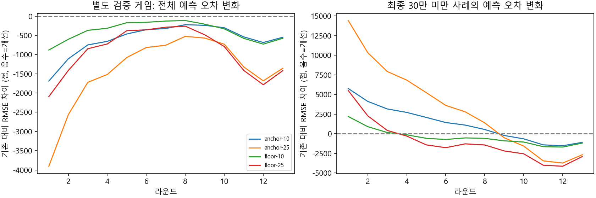
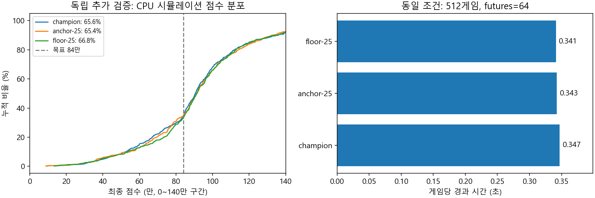

# 기존 CPU 모델의 GPU 미세 조정

기존 13라운드 x 656개 가중치를 유지하고 보정량만 GPU에서 학습한다. 모델 구조,
CPU 계산 방식, 게임 규칙과 RNG는 바꾸지 않는다. GPU가 없는 배포 환경에서도
기존 `rounds` JSON 형식으로 동작한다. 일반적인 트리 모델 탐색과 검증 조건은
[GPU 모델 탐색](GPU-MODEL-SEARCH.md)에 있다.

## 보정 방식

- 기존 모델의 840k 상한 예측과 시뮬레이션 최종 점수 사이의 잔차를 학습한다.
  이미 상한에 도달했고 실제 결과도 상한인 사례는 불필요하게 값을 내리지 않는다.
- 라운드별 가중 최소제곱을 CUDA/CuPy float64로 계산한다. 관측되지 않은 특징의
  가중치를 유지하도록 기존 값에 대한 규제를 적용한다.
- 규제 대각은 `0.1 * diag(X'WX) + 0.0001 * N`이다. 학습한 보정량의 10% 또는
  25%만 기존 가중치에 더한다. 가중치 개수/특징 추출 비용은 동일하다.
- 일반 후보는 모든 사례의 가중치를 1로 둔다. 저점 후보는 최종 300k 미만 사례의
  가중치를 2로 둔다. 추천의 목표 함수를 변경하는 것은 아니다.
- 학습 데이터는 기존 모델의 정책에 3% 무작위 탐색을 섞어 만든다. 보드별 예측 오차가
  줄어드는 것과 더 좋은 선택으로 실제 최종 점수를 얻는 것은 구분해서 검증한다.

## 실행

`tools/tli-companion`에서 실행한다. CUDA 13 개발 환경에만 CuPy를 설치하며
배포 ZIP에는 포함하지 않는다. 다른 CUDA 버전의 학습 환경에서는 공식 CuPy 설치
안내에 맞는 별도 환경이 필요하다.

```powershell
qa/gpu-search/venv/Scripts/python -m pip install -r vorax/scripts/requirements-finetune.txt
cargo build --release --locked -p vorax-cli -j 2 --manifest-path vorax/Cargo.toml

# 새 시드의 학습 50,000게임 / 검증 10,000게임, CPU 2스레드.
qa/gpu-search/venv/Scripts/python vorax/scripts/gpu_finetune.py --run qa/gpu-finetune/run01

# 후보 선별. 이전 탐색에 사용한 92M/93M 시드를 재사용하지 않는다.
qa/gpu-search/venv/Scripts/python vorax/scripts/gpu_search.py screen --run qa/gpu-finetune/run01 --eval-seed 96000000 --eval-games 128 --futures 64

# 결과를 열기 전에 정한 두 후보를 97M부터 시작하는 별도 512게임에서 비교.
# 64 futures이므로 이는 추가 선별이며 출고 승인은 아니다.
qa/gpu-search/venv/Scripts/python vorax/scripts/gpu_search.py holdout --run qa/gpu-finetune/run01 --eval-seed 96000000 --eval-games 512 --futures 64 --finalists anchor-25,floor-25
```

`--finalists`는 학습이 완료된 서로 다른 후보만 받는다. 여러 후보를 같은 추가 검증에서
비교하면 Bonferroni 보정 p값도 기록한다. 실제 출고 검증은 새로 보지 않은 시드에서
후보를 미리 확정하고 최소 4096게임/256 futures로 수행해야 한다. 이미 본 97M 구간을
다시 최종 검증으로 사용하지 않는다. 스크립트는 모델을 자동 교체하지 않는다.

## 출력과 검증

- `fit.json`: 학습/검증 시드, 가중치/엔진 해시, GPU 계산 시간, 라운드별 오차와 후보.
- `finetune.png`: 기존 대비 예측 오차 변화. 0 아래가 개선이다.
- `screen.png`, `holdout.png`: CPU에서 실제 선택을 진행한 점수 분포와 시간.
- `train --rows --linear`: 라운드, CPU 선형 특징, 최종 상한 점수의 float32 행.
- `train --probe --linear`: 실제 CPU 예측과 원래 float64 특징을 함께 기록한다.
  GPU/NumPy와 실제 Rust CPU 예측 차이는 0.000001점 이하를 요구한다.

GPU와 CPU에서 동일한 작은 행렬의 보정값을 비교하는 테스트를 포함한다.

```powershell
$env:VORAX_TEST_CUDA = '1'
qa/gpu-search/venv/Scripts/python -m unittest discover -s vorax/scripts -p test_gpu_search.py -v
```

개발 환경 설정은 [CuPy 공식 설치 문서](https://docs.cupy.dev/en/stable/install.html)를 참고한다.

## 2026-11-02 추가 실험 결과

기존 가중치를 기준으로 4개 후보를 만들었다. 새로운 50,000게임에서 983,549개 상태,
별도 10,000게임에서 196,840개 상태를 생성했다. GPU 전송/보정 계산/검증 오차 계산은
라운드별 합계 25.6초였으며 CPU 데이터 생성과 준비 시간은 제외한 값이다.
각 후보를 880개 상태에서 확인했고 GPU/NumPy와 실제 Rust CPU 예측 차이는
0.000000001점 미만이었다. 가중치 개수는 모든 후보에서 13 x 656개다.



128게임 선별에서는 일반 25% 보정의 84만 달성률이 60.2% -> 65.6%,
저점 가중 25% 보정의 하위 10%가 454,483 -> 670,206으로 나왔다.
이를 최종 개선으로 간주하지 않고 결과를 열기 전에 두 후보를 확정하여 별도
512게임(97,000,000~97,000,511)에서 비교했다. 모두 64 futures, CPU 2스레드,
리롤 3/1이다.

| 지표 | 기존 | 일반 25% | 저점 가중 25% |
|---|---:|---:|---:|
| 840k 달성 | 336/512 (65.6%) | 335/512 (65.4%) | 342/512 (66.8%) |
| 840k 상한 평균 | 759,651 | 762,215 | 768,254 |
| 하위 10% (보간 분위수) | 530,661 | 550,979 | 537,661 |
| 300k 미만 | 9회 | 12회 | 11회 |
| 평균 몬스터 수 | 1,860.6 | 1,822.4 | 1,854.9 |
| 전체 실행 시간 | 177.6초 | 175.5초 | 174.7초 |

저점 가중 후보는 기존 `vorax gate`의 완화된 기준은 통과했다. 그러나 새로 달성한 게임
90개/기존 대비 실패한 게임 84개로, paired p=0.705 및 두 후보 보정 p=1.0이다.
상한 평균 차이의 paired bootstrap 95% 구간도 -7,749~+24,786점으로 0을 포함한다.
30만 미만 횟수도 늘어 더 엄격한 채택 기준을 통과하지 못했다. **기존 배포 모델을 유지했다.**
계산 속도 증가는 관찰되지 않았으나 작은 시간 차이를 속도 개선으로 주장하지 않는다.



GPU/CPU 대조를 포함한 Python 검사 16개, Rust 기본 검사 74개가 통과했다.
설치형 OCR 검사 7개는 변경 범위가 아니어서 미실행이다. 기존 트리 probe 출력은
이전 엔진과 바이트 일치했고, GPU를 끈 상태의 미세 조정은 데이터 생성 전에 거부됐다.
기존 ZIP 1,007개 항목에 새 GPU 학습 파일은 없다. 256 futures 출고 검증, 실게임,
모델 교체와 새 릴리스는 수행하지 않았다.

[설정, 가중치 해시, 학습 지표, 원시 점수와 신뢰 구간](benchmarks/gpu-finetune-20261102.json)
