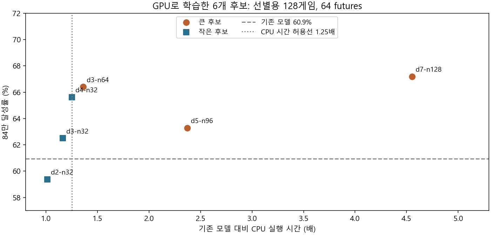
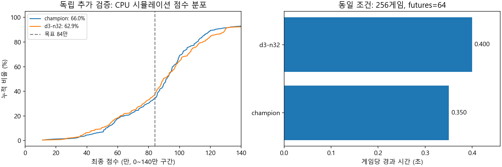

# GPU 모델 탐색 / CPU 배포

개발용 모델 학습과 검증 오차 계산은 NVIDIA GPU에서 실행한다. 후보 모델은 기존
`boardValue.json` 트리 형식으로 내보낸다. 배포판은 Rust CPU 엔진으로 실행하며,
Python, XGBoost, CUDA를 설치하거나 동봉하지 않는다.

게임 규칙 시뮬레이션 전체를 CUDA로 이식한 것은 아니다. 학습 데이터를 만드는 게임과
후보의 실제 추천 성능을 비교하는 게임은 동일한 CPU 규칙 엔진으로 실행한다.
기본 CPU 스레드는 2개이며 Windows 자식 프로세스 우선순위는 BelowNormal이다.
GPU 학습도 게임과 GPU 자원을 공유하므로 게임 중에는 실행하지 않는 편이 좋다.

## 실행

`tools/tli-companion`에서 실행한다. 개발용 Python 환경은 `qa/` 아래에만 생성한다.
Rust CLI는 현재 소스/모델로 먼저 Release 빌드해야 한다.

```powershell
python -m venv qa/gpu-search/venv
qa/gpu-search/venv/Scripts/python -m pip install -r vorax/scripts/requirements-gpu.txt
cargo build --release --locked -p vorax-cli -j 2 --manifest-path vorax/Cargo.toml

# 학습 50,000게임 / 검증 10,000게임. 결과 디렉터리는 매번 새로 지정한다.
qa/gpu-search/venv/Scripts/python vorax/scripts/gpu_search.py fit --run qa/gpu-search/run01

# 동일한 128개 새 게임에서 후보 3개를 CPU 배포 엔진으로 비교한다.
qa/gpu-search/venv/Scripts/python vorax/scripts/gpu_search.py screen --run qa/gpu-search/run01 --eval-games 128 --futures 64

# 선별된 후보 1개만 별도 512게임 / 256 futures로 최종 검증한다.
qa/gpu-search/venv/Scripts/python vorax/scripts/gpu_search.py holdout --run qa/gpu-search/run01 --eval-games 512 --futures 256
```

펫에 따른 리롤 조건은 `--potion-refreshes`, `--instrument-refreshes`로 지정한다.
기본값은 3/1이며 학습과 평가에서 같은 값을 사용해야 한다. 다른 펫/리롤 조건에 대한
개선은 별도 검증 없이 주장하지 않는다. `--threads`로 CPU 사용 스레드 수를 조절한다.
Ctrl+C로 중단하면 실행 중인 CPU 시뮬레이터도 종료한다. CUDA 초기화 실패 또는
CPU로의 자동 전환이 감지되면 학습은 실패 처리한다.

## 무엇을 비교하는가

- 학습/검증을 게임의 난수 시드로 분리한다. 같은 게임의 상태가 양쪽으로 섞이지 않는다.
- GPU에서 깊이/트리 수가 다른 3개 회귀 모델을 학습한다. 정답은 최종 점수를
  840,000에서 자른 값이며, 미니게임의 남은 선택 결과를 예측한다.
- 기본 `--profile compact`는 깊이 2/3/4, 트리 32개의 작은 후보를 비교한다.
  `--profile full`은 깊이 3/5/7, 트리 64/96/128개다. CPU 비용 때문에 선별 단계는
  기존 실행 시간 1.25배 이내의 후보를 우선한다. 해당 후보가 없으면
  `within_cpu_budget=false`로 기록한다.
- GPU 예측 오차가 작은 모델이 실제 게임에서도 좋은지는 별개의 문제다.
  `screen`은 각 후보의 실제 840k 달성률, 상한 평균, 하위 10% 점수,
  300k 미만 횟수, 몬스터 수/사용 탱크 수와 CPU 실행 시간을 비교한다.
- 최종 `holdout`에서 최소 512게임 / 256 futures, 기존 `vorax gate` 통과, paired binomial p < 0.05,
  하위 10%/300k 미만 횟수 비악화, 기존 대비 실행 시간 1.25배 이내를 모두 요구한다.
  이는 같은 게임 수/CPU 스레드/탐색량의 전체 실행 시간이다. OCR과 실시간 화면 지연은
  별도 확인해야 한다. `screen`은 후보 선택용이며 출시 근거로 사용하지 않는다.
- 조건을 통과해도 스크립트는 배포 모델을 덮어쓰지 않는다. `eligible_for_review`를
  기록한다. 조건을 충족하지 않으면 `keep_champion`이다. 여러 번 모델을 조정했다면
  기존 holdout을 재사용하지 말고 새로운 `--eval-seed` 범위를 지정해야 한다.

## CPU 변환 검증

GPU 라이브러리는 float32 특징을 사용하지만 CPU 엔진은 float64 특징을 사용한다.
내보내기에서 트리 분기 경계를 보정하여 반올림 경계에서 선택이 달라지지 않도록 한다.
회귀 트리의 잎/기본값은 원래 float32 값을 정확히 보존한다. 숫자형 단일 출력
`reg:squarederror` / `gbtree`만 지원한다.

`train --probe`는 모델과 무관한 고정 무작위 경로에서 실제 `board_value` 결과와
전체 정밀도 특징을 기록한다. CPU 엔진/내보낸 트리 해석기 오차는 0.000001점 이하,
CPU/GPU 오차는 float32 합산 차이를 고려해 2점 이하를 요구한다. 게임 규칙/RNG와
CPU 추천 계산 방식은 변경하지 않는다.

## 기록과 시각화

각 실행 폴더의 `fit.json`, `screen.json`, `holdout.json`에 설정과 결과를 남긴다.
모델/엔진 해시, GPU 사용 여부, 게임 시드 범위, 학습 곡선, CPU 변환 오차와 원시 점수를
보존한다. `commands.jsonl`에는 명령/실행 시간/종료 코드를 기록한다. 이 개발용 기록에는
로컬 경로가 있으므로 공개 보고에는 필요한 수치만 추려서 사용한다.

- `data.png`: 라운드별 학습/검증 상태 수와 정답 분포.
- `learning.png`: 후보별 GPU 학습 곡선.
- `screen.png`, `holdout.png`: CPU 시뮬레이션 점수 누적 분포와 게임당 시간.

검사:

```powershell
qa/gpu-search/venv/Scripts/python -m unittest discover -s vorax/scripts -p test_gpu_search.py -v
cargo test --release --workspace --locked --manifest-path vorax/Cargo.toml
```

GPU 라이브러리의 학습/CPU 추론 분리는
[XGBoost 공식 GPU 문서](https://xgboost.readthedocs.io/en/release_3.2.0/gpu/)를 따른다.
게임 규칙은 저장소의 MIT 기준과 검증된 현행 수정만 사용한다.

## 첫 실행 결과 (2026-11-02)

기존 배포 모델을 유지했다. GPU 학습/CPU 변환 경로는 동작하지만, 이번 후보가
점수를 개선했다는 근거는 얻지 못했다.

- GPU에서 후보 6개를 실제 학습했다. 같은 50,000게임의 981,091개 상태로 학습하고,
  별도 10,000게임의 196,105개 상태로 오차를 비교했다. 각 후보의 학습은 약
  0.22~1.27초였다. 데이터 생성/전송/초기화/게임 시뮬레이션 시간은 제외한 값이다.
- CPU 내보내기는 후보마다 같은 871개 상태로 대조했다. 실제 Rust CPU와 내보낸
  트리 해석기는 오차 0점, GPU float32 예측과는 최대 0.253점 미만이었다.
- 깊은 트리는 선별용 달성률이 높아도 CPU 비용이 컸다. 깊이 7/128개 트리는 기존
  실행 시간의 4.55배였다. CPU 시간 1.25배 이내의 작은 `d3-n32`를 추가 검증했다.



후보 선택에 사용하지 않은 256게임, 64 futures, CPU 2스레드, 리롤 3/1 조건:

| 지표 | 기존 모델 | GPU 후보 d3-n32 |
|---|---:|---:|
| 840k 달성 | 169/256 (66.0%) | 161/256 (62.9%) |
| 840k 상한 평균 | 758,672 | 749,328 |
| 하위 10% (보간 분위수) | 529,437 | 496,325 |
| 300k 미만 | 4회 | 5회 |
| 평균 몬스터 개체 수 | 1,829.8 | 1,789.5 |
| 평균 사용 탱크 수 | 3.84 | 3.54 |
| 전체 실행 시간 | 89.7초 | 102.3초 |

새로 목표를 달성한 게임 48개, 기존에는 달성했으나 후보에서 실패한 게임 56개였다.
paired p=0.493이며 기존 gate도 실패했다. 개선이 확인되지 않아 더 비싼
512게임/256 futures 출고 검증은 실행하지 않았다. 이 결과로 모든 GPU 학습 방식이
나쁘다고 결론내릴 수는 없다. 후보를 조정한 후에는 새로운 독립 시드가 필요하다.



Python 검사 9개, Rust 기본 workspace 검사 74개가 통과했다. 설치된 OCR을 요구하는
7개 검사는 이번 개발 도구 변경에서 실행하지 않았다. GPU를 비활성화한 프로세스에서
CPU 예측은 동일했고, GPU 학습은 데이터 생성 전에 거부됐다. 기존 portable ZIP
1,007개 항목 중 새 GPU 학습 파일/라이브러리는 0개다. 실게임 확인, 배포 모델 교체와
새 릴리스는 수행하지 않았다.

[모든 후보의 학습 곡선, 선별/추가 검증 원시 점수와 설정](benchmarks/gpu-model-search-20261102.json)
