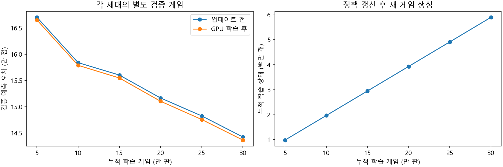
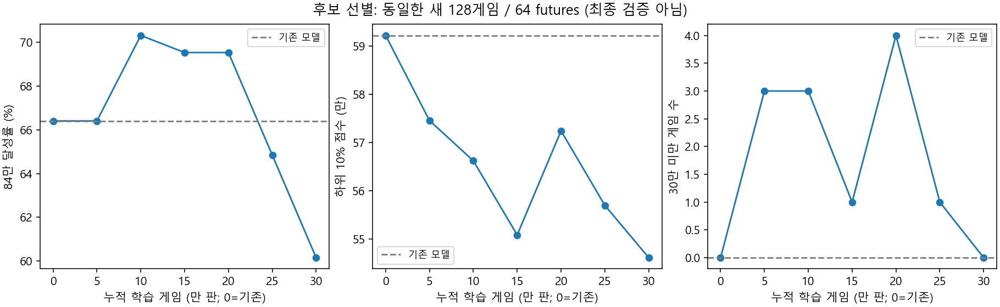
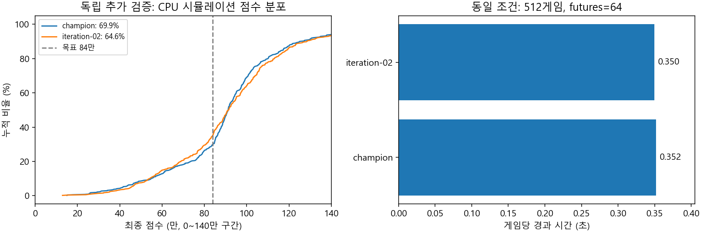

# 반복 강화학습 실험

`vorax/scripts/gpu_rl.py`는 기존 CPU 선형 모델을 초기값으로 사용하는 몬테카를로
근사 정책 반복 실험이다. 이전의 단발성 회귀 학습과 달리, 매 세대에서 갱신한 모델이
다음 세대의 선택을 결정한다. 생성된 게임의 최종 보상을 GPU로 학습하고 다시 플레이한다.
PPO나 심층 신경망 학습은 아니며, 실제 게임을 자동 조작하지 않는다.

## 학습과 평가

1. 현재 모델로 50,000게임을 진행한다. 합법 선택지/리롤에 대한 무작위 탐색을 섞는다.
2. 방문한 상태마다 그 게임의 최종 보상 `min(점수, 840000) / 1000000`을 기록한다.
3. CUDA/CuPy float64로 기존 예측과 최종 보상의 차이를 학습한다. 기존 미세 조정의
   규제 `0.1 * diag(X'X) + 0.0001 * N`을 사용하고 보정량의 25%를 반영한다.
4. 새로운 5,000게임의 상태로 예측 오차를 측정하고 CPU 내보내기를 검증한다.
   이 검증 게임은 해당 세대의 학습 전 정책으로 생성하며 가중치 학습에 쓰지 않는다.
5. 새 모델로 다음 50,000게임을 생성한다. 총 6세대, 학습 300,000게임/검증 30,000게임이다.
   탐색 비율은 8%에서 2%까지 줄인다. 관측되지 않은 특징의 가중치는 유지한다.
6. 6개 체크포인트를 같은 별도 시드의 CPU 추천기로 비교한다. 한 후보를 정한 뒤
   한 번도 보지 않은 시드에서 기존 모델과 비교한다. 학습 오차 감소와 점수 개선은 별개다.

전체 학습/검증/후보 선별/독립 비교의 게임 시드를 분리한다. 각 세대의 행동 모델 해시,
데이터 해시, 시드, 탐색률, 가중치 및 GPU/CPU 계산 오차를 `fit.json`에 보관한다.
대용량 원시 상태 행은 해당 세대의 체크포인트를 검증한 뒤 삭제한다. 해시와 생성 조건으로
재생성할 수 있다. 완료한 체크포인트는 보존하며 같은 실행 폴더를 덮어쓰지 않는다.

게임 규칙과 데이터 생성은 CPU 2스레드, 가중치 학습은 GPU다. 전체 게임 시뮬레이션을
CUDA로 이식한 것은 아니다. 배포 모델은 기존과 같은 13 x 656개 가중치이므로 CUDA,
CuPy와 학습용 Python이 필요하지 않으며 CPU 추론 복잡도도 바뀌지 않는다.

## 실행

`tools/tli-companion`에서, [기존 GPU 개발 환경](GPU-FINETUNE.md)을 사용한다.

```powershell
# 실행 중 변경되지 않을 검증된 CLI를 --engine으로 지정한다.
qa/gpu-search/venv/Scripts/python vorax/scripts/gpu_rl.py --run qa/gpu-rl/run01 --engine qa/gpu-finetune/engine.exe

# 98M부터 128개의 새 게임. 6개 세대별 체크포인트를 배포용 선택 알고리즘으로 선별.
qa/gpu-search/venv/Scripts/python vorax/scripts/gpu_search.py screen --run qa/gpu-rl/run01 --engine qa/gpu-finetune/engine.exe --eval-seed 98000000 --eval-games 128 --futures 64

# 선별이 끝나면 99M부터 512개의 독립 게임에서 한 후보를 비교한다.
qa/gpu-search/venv/Scripts/python vorax/scripts/gpu_search.py holdout --run qa/gpu-rl/run01 --engine qa/gpu-finetune/engine.exe --eval-seed 98000000 --eval-games 512 --futures 64
```

64 futures 평가는 추가 선별이다. 개선이 확실할 때만 미사용 시드에서 최소 4096게임/256 futures의
출고 검증을 별도로 진행한다. 기존 gate와 신뢰도/저점/CPU 지연 조건을 모두 확인하며,
스크립트는 배포 가중치나 설치된 프로그램을 교체하지 않는다.

## 해석 범위

학습 플레이어는 기존 `train::play`의 2표본 가치 기반 정책이며 배포판의 깊은 탐색과
같지 않다. 모델은 보드 특징을 근사하고 게임 규칙도 현재 시뮬레이터를 기준으로 한다.
세대마다 정책과 탐색률이 달라 검증 상태의 분포도 바뀐다. 따라서 예측 오차 그래프의
세대 간 하락을 고정된 시험에서의 실력 향상으로 해석하지 않는다.
따라서 반복 횟수만으로 실게임 개선이나 최적 정책 수렴을 보장하지 않는다. 최종 몬스터
수는 기존 추천기의 동률 우선순위와 평가 지표로 보존하며 점수 보상을 낮추는 추가 벌점은
이번 실험에 넣지 않았다.

개념 근거: Sutton/Barto의 [Monte Carlo Methods 강의 자료](https://people.cs.umass.edu/~barto/courses/cs687/Chapter%205.pdf).
완료한 게임의 보상으로 정책을 평가하고 개선된 정책으로 다시 경험을 얻는 구조를 따른다.

## 2026-11-02 실험

RTX 4060 Laptop에서 학습 300,000게임의 5,900,782개 상태와 별도 30,000게임의
590,016개 검증 상태를 생성했다. 데이터 생성 명령은 합계 165.0초, GPU 전송/학습/
오차 계산은 40.3초다. 파일 검증, CPU 내보내기 확인과 그래프 작성 시간은 별도다.
세대별 CPU/NumPy/GPU 예측 오차는 1e-9점 미만이며, 매 세대의 행동 모델 해시가
직전 체크포인트 해시와 일치한다. CPU 게임 엔진의 규칙/RNG/특징은 변경하지 않았다.



98,000,000부터 시작하는 동일 128게임, 64 futures, CPU 2스레드, 리롤 3/1로
기존 모델과 6개 체크포인트를 선별했다.

| 누적 학습 | 84만 달성 | 상한 평균 | 하위 10% | 30만 미만 |
|---|---:|---:|---:|---:|
| 기존 | 85/128 | 781,067 | 592,230 | 0 |
| 5만 | 85/128 | 772,182 | 574,562 | 3 |
| 10만 | 90/128 | 770,503 | 566,214 | 3 |
| 15만 | 89/128 | 767,451 | 550,824 | 1 |
| 20만 | 89/128 | 773,337 | 572,435 | 4 |
| 25만 | 83/128 | 769,337 | 556,959 | 1 |
| 30만 | 77/128 | 755,220 | 546,111 | 0 |



학습 오차는 낮아졌지만 더 긴 학습이 추천 점수 개선으로 이어지지는 않았다.
사전에 정한 달성률 우선 선별 기준으로 10만 판 체크포인트 하나를 독립 비교 대상으로
확정했다. 이 선별 자료 자체를 배포 근거로 사용하지 않는다.

99,000,000부터의 독립 512게임, 64 futures에서 다음 결과를 얻었다.

| 지표 | 기존 모델 | 10만 판 체크포인트 |
|---|---:|---:|
| 84만 달성 | 358/512 (69.9%) | 331/512 (64.6%) |
| 84만 상한 평균 | 770,792 | 766,785 |
| 하위 10% | 550,496 | 543,791 |
| 30만 미만 | 11 | 7 |
| 최종 평균 개체 수 | 1,891.0 | 1,904.5 |
| 최종 평균 점유 탱크 | 3.98 | 3.98 |

후보만 성공한 게임 75개, 기존만 성공한 게임 102개, paired 양측 p=0.05036이다.
30만 미만 빈도는 줄었으나 목표 달성률, 상한 평균과 하위 10% 점수 개선이 없어 기존
모델을 유지한다. paired bootstrap 5,000회에서 상한 평균 차이의 95% 구간은
-19,716 ~ +10,615점이다. 이 표본으로 저점 개선이나 실전 성능 향상을 확정하지 않는다.
게임당 시간은 양쪽 약 0.35초다. 기준 모델 평가 초반에 Rust 회귀 검사 일부가 겹쳤으므로
작은 시간 차이를 속도 개선의 근거로 쓰지 않는다.



- Python 테스트 20개 통과(CUDA/CPU 수치 대조 포함).
- Rust workspace 74개 통과, 실패 0개, 설치형 OCR 7개 미실행. 기존 dead-code 경고 6개.
- 작은 실제 실행 2세대/1,000게임, 이후 6세대/300,000게임의 정책 전달 및 CPU 내보내기 확인.
- CUDA 비활성 환경에서는 학습을 거부하며 게임 생성 전 종료하는 것을 확인.
- `vorax gate`: `pass=no`. 256 futures 출고 검증과 실제 게임 확인은 수행하지 않았다.
- 1.0.9 배포 모델 SHA-256 `31acf8fc57fd7af8000ca0a8ab57191ecb1730d6431ce532d235fdc74c3582af` 유지.
  모델 교체, 자동 머지, 새 앱 릴리스는 하지 않았다.

원시 점수, 학습 설정, 모델 해시, 신뢰 구간:
[gpu-rl-20261102.json](benchmarks/gpu-rl-20261102.json).
