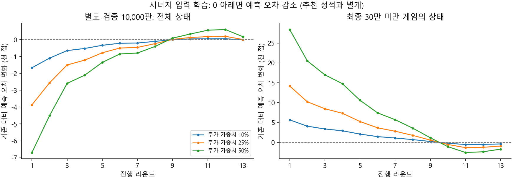
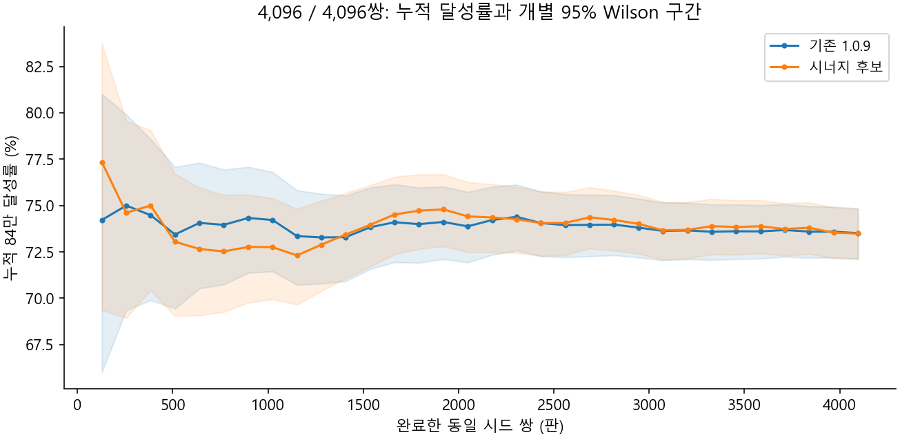
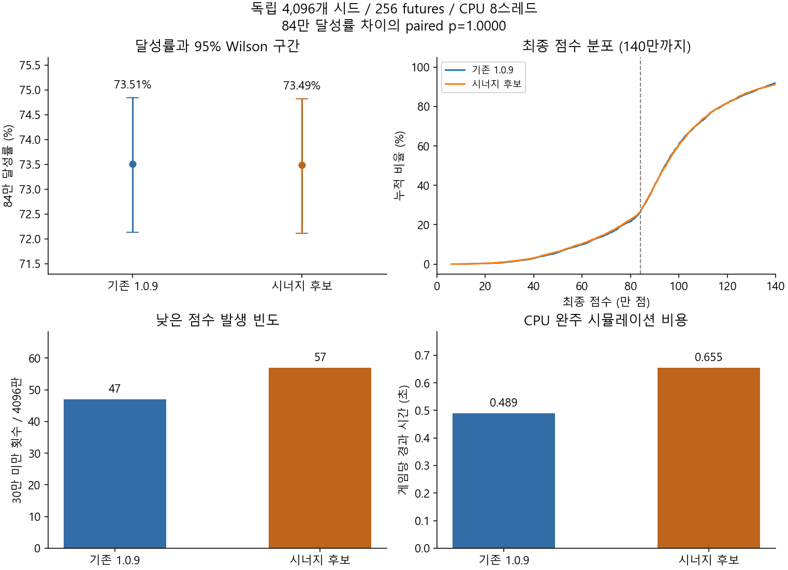

# 시너지 입력 확장과 4,096판 검증

기존 선형 모델이 같은 상태로 취급하던 종족과 희귀도의 결합, 도구별 중복 수,
주기성 도구의 획득 시점을 새 입력으로 보존한다. GPU에서 추가 가중치를 학습하고,
실제 추천에 쓰이는 Rust CPU 엔진으로 별도 4,096개 시드를 비교한다.
입력 개선과 추천 성적 개선은 별개의 검증이다. 이 도구는 배포 모델을 자동 교체하지 않는다.

## 입력과 추론

기존 13라운드 x 656개 가중치는 고정한다. 각 라운드에 다음 564개 입력을 추가한다.

| 입력 | 개수 | 정규화 |
|---|---:|---|
| 종족 4종 x 희귀도 4종별 탱크 수, 활성 합, 수량 합, 수량*활성 합 | 64 | 각각 /6, /1000, /3000, /1,000,000 |
| 도구별 보유 개수, 현재 예정 발동 수, 13라운드까지 남은 예정 발동 수, 획득 후 경과 라운드 합 | 25 x 4 | /3; 남은 횟수와 경과는 추가 /13 |
| 도구별 보유 개수와 종족/희귀도별 탱크 수의 곱 | 25 x 16 | /3, 탱크 수는 /6 |

합계 1,220개. 도구별 횟수는 중복을 포함하며 reactive 효과는 예정 발동 수가 0이다.
이 특징은 조건 충족 여부와 무관한 발동 일정을 표현한다. 실제 효과/조건/RNG는 기존
게임 시뮬레이터가 계산한다. 수량과 활성을 무조건 1:1로 만드는 가산점은 사용하지 않는다.
같은 종족/희귀도 안의 개별 탱크 분포까지 완전히 보존하는 표현은 아니다.

추론은 고정 크기 스택 버퍼와 보유 도구만 사용한다. 남은 발동 수는 라운드 반복 대신
정수 나눗셈으로 계산한다. 추론 중 새 힙 할당이나 GPU 호출은 없다.
기존 모델의 계산 순서와 RNG는 유지한다.

모델 JSON은 `synergy_version: 1`, `legacy_rounds`, `synergy_rounds`를 사용한다.
버전/13라운드/열 수/유한 계수를 검사한다. 구버전 엔진은 이 형식을 읽지 못하므로
새 JSON만 기존 1.0.9 실행 파일에 넣으면 안 된다. CUDA/CuPy/Python은 개발 도구에만 필요하다.

## 학습과 평가 분리

- 행동 정책: 기존 champion을 쓰는 빠른 가치 정책(`samples=2`, `horizon=0`),
  탐험 확률 0.03, 5만 판. 별도 검증 1만 판. 실제 최종 검증의 solver 정책과는 다르다.
- CUDA float64 ridge 회귀로 `최종 상한 점수 - 기존 원시 예측`의 잔차를 새 입력에 학습한다.
  정규화는 대각 성분의 0.1배와 상태 수의 0.0001배다.
- 보정 강도 0.10/0.25/0.50의 후보 3개를 사전에 고정한다. 기존 가중치는 갱신하지 않는다.
- 선별 128판/64 futures는 후보 하나를 정하는 용도다. 최종 검증 시드와 겹치지 않는다.
- 최종 검증은 기존/선택 후보 각각 동일한 새 4,096개 시드, 256 futures, CPU 8스레드,
  물약 리롤 3/도구 리롤 1이다. 총 8,192개의 완주 시뮬레이션이다.
- 후보/엔진/모델 해시, 시드, 판 수, 탐색 깊이, 판정 기준을 `holdout-plan.json`에 고정한다.
  128판씩 저장하며 기존/후보 실행 순서를 번갈아 바꾼다. 완료 구간의 해시와 시드를 검사해
  재개한다. 중간 p값으로 중단하거나 후보/표본 수를 바꾸지 않는다.
- 채택 검토 조건: native gate, paired exact p<0.05, p10 및 30만 미만 빈도 비악화,
  CPU 완주 시간 1.25배 이내. 84만 목표는 현재 시뮬레이터의 설정이다.
  저점 조건은 관측값 비교이며 통계적 비열등성 검정을 뜻하지 않는다.
  실제 보상 문턱/게임 규칙과의 일치, 실게임 OCR은 이번 학습 실험에서 새로 검증하지 않는다.

남은 몬스터 수와 탱크 수는 전투 시간의 대리 지표이며 실제 전투 시간을 측정한 결과가 아니다.
이번 실험은 리롤 3/1 설정 한 가지에 대한 검증이다.

학습 판 수는 독립 평가 표본 수에 포함하지 않는다. 4,096판으로 작은 모든 차이를
확정할 수 있는 것은 아니다. 표본 계획과 신뢰구간 해석은
[시너지/통계 감사](SYNERGY-STATISTICS.md)를 참고한다.

## 재현

`vorax/scripts/requirements-finetune.txt`의 개발 환경과 CUDA가 필요하다.
아래 명령은 프로젝트 루트에서 실행한다. 실행 중에는 엔진과 모델 파일을 바꾸지 않는다.

```powershell
cargo test --release --workspace --manifest-path vorax/Cargo.toml
cargo build --release -p vorax-cli --manifest-path vorax/Cargo.toml
python vorax/scripts/gpu_synergy.py --run qa/gpu-synergy/run01 --threads 8
python vorax/scripts/gpu_search.py screen --run qa/gpu-synergy/run01 --threads 8 --eval-seed 100000000 --eval-games 128 --futures 64
python vorax/scripts/gpu_gate.py --run qa/gpu-synergy/run01 --engine vorax/target/release/vorax.exe --threads 8
```

학습행 파일은 float32, 학습과 추론 계수는 float64다. CPU 내보내기는 별도 전체 정밀도
보드로 검증한다.

## 2026-11-03 완료 결과

이번 후보는 채택하지 않는다. 입력을 구별하는 데 성공했지만 최종 추천 성적의 개선은
확인하지 못했고, 관측 저점 지표와 CPU 비용도 교체 기준을 통과하지 못했다.
기존 1.0.9 및 기본 가중치 SHA256 `31acf8fc57fd7af8000ca0a8ab57191ecb1730d6431ce532d235fdc74c3582af`를 유지했다.

- 학습: 50,000게임/983,526상태, 별도 검증: 10,000게임/196,661상태.
  CUDA 전송/학습/오차 계산 38.67초. 게임 생성 223.36초와 파일 처리 시간은 별도다.
- 기존 656개 가중치를 보존하고 새 입력 564개를 학습했다. 후보별 추가 계수
  7,332개 중 6,757개가 0이 아니다. 세 입력 충돌 사례 모두 새 특징으로 구분된다.
- 선별 128게임/64 futures: 기존 81회, 10% 후보 85회, 25% 후보 83회,
  50% 후보 95회가 84만에 도달했다. 최고 후보인 50%를 최종 검증 전에 고정했다.
- 최종 시드는 101000000~101004095, 모든 시드에 기존/후보 각각 한 게임씩,
  256 futures/CPU 8스레드/리롤 3,1이다. 32개 구간을 전부 끝냈다.

| 지표 | 기존 1.0.9 | 시너지 50% 후보 |
|---|---:|---:|
| 84만 달성 | 3,011/4,096 (73.51%) | 3,010/4,096 (73.49%) |
| 달성률 95% Wilson 구간 | 72.14%~74.84% | 72.11%~74.82% |
| 84만 상한 평균 | 784,590 | 782,155 |
| 하위 10% 점수 | 604,109 | 592,637 |
| 30만 미만 | 47 (1.15%) | 57 (1.39%) |
| 평균 몬스터 수 | 1,978.0 | 1,946.9 |
| 평균 탱크 수 | 3.858 | 3.867 |
| CPU 완주 시간 합계 | 2,003.29초 | 2,682.77초 |

같은 시드에서 후보만 성공한 게임은 503개, 기존만 성공한 게임은 504개다.
84만 달성률의 정확 paired p=1.0이며 native gate도 실패했다. 상한 평균 차이는
-2,435점, paired bootstrap 5,000회의 95% 구간은 -6,663~1,880점이다.
30만 미만 증가의 paired p=.343이므로 실제 악화가 통계적으로 확정됐다고도 주장하지 않는다.
관측 저점 지표가 교체 조건을 만족하지 않았다는 판단이다.

평균 몬스터 수는 1.6% 줄었지만 달성률/저점 개선을 대신하지 않는다. 전체 CPU 완주
비용은 33.9% 증가했다. 이 시간은 병렬 시뮬레이션의 경과 시간이며 오버레이 표시 지연이나
실제 전투 시간은 아니다. 짧은 Python 검사와 간헐적인 그래프 생성도 같은 장비에서 수행했으므로
작은 시간 차이를 엄밀한 단독 성능 측정으로 해석하지 않는다.

4,096판의 결과로 이번 후보의 개선 근거가 없다는 판단은 가능하지만, 기존 모델이 모든
가능한 모델 중 최선이라는 결론은 아니다. 학습의 빠른 가치 정책과 최종 solver 정책의
차이도 남아 있다. 후속 후보는 이번 최종 시드로 재선별하지 않고 새 독립 검증이 필요하다.

검증: Rust 77개, Python 31개(CUDA 대조 포함) 통과. 설치형 OCR 7개는 미실행했다.
구/신 엔진과 0 추가 계수 모델에서 881보드 예측, 48게임 학습행, 24게임 solver 결과가
bit exact였다. 세 후보 각각 875보드의 CPU/NumPy/GPU 오차는 1e-9점 미만이다.
GPU를 숨긴 실행은 게임 생성 전에 exit 1로 종료했고 CPU 학습으로 우회하지 않았다.
완료된 작업을 재개하면 64개 모델별 구간을 재사용하고 새 게임 0개로 동일한 최종 보고서를 생성했다.
새 실게임 검증, 모델 교체, 새 릴리스는 하지 않았다.

[전체 결과와 8,192개 원시 완주 점수](benchmarks/gpu-synergy-20261103.json),
[실험용 CPU 가중치](benchmarks/gpu-synergy-candidate-20261103.json).
이 가중치는 배포 기본 모델이 아니며 새 synergy-v1 reader로만 읽을 수 있다.






