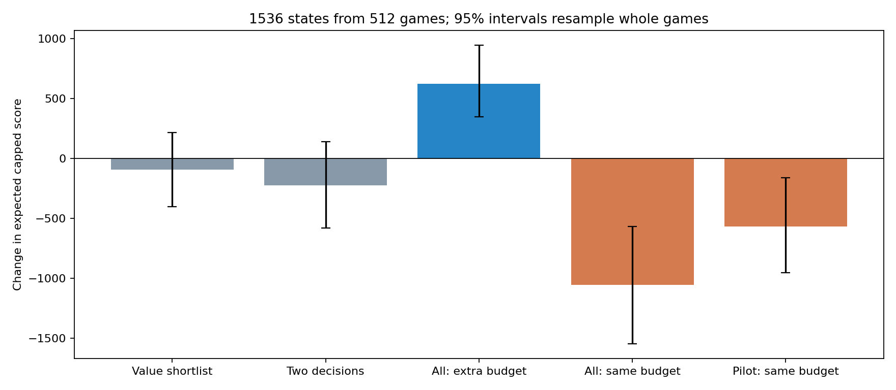
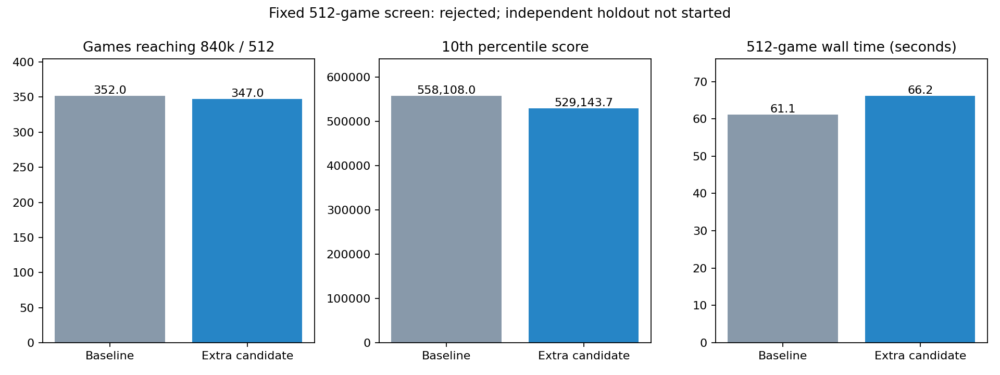

# 후보 탐색 점검 및 실험 결과

2026-11-04. 후보 탈락을 재현하고 개선안을 구현했지만, 독립 완주 선별에서 채택 기준을
통과하지 못했다. 기존 1.0.9 설치본과 기본 모델은 유지했다. 이번 작업에서 새 GPU 학습은 하지 않았다.
검증되지 않은 개선 탐색을 학습 데이터 생성 정책으로 사용하지 않았다.

## 확인된 구조와 재현 사례

수술 도구는 모든 카드와 리롤을 비교한다. 포션은 각 카드의 이번 라운드 최고 대상,
전체 상위 일부 대상만 끝까지 계산한다. 따라서 특정 도구 시너지의 장기 가치가 있는
다른 대상이 후보에서 빠질 수 있다. 이는 모든 수술 도구 선택 오류의 원인이라는 뜻은 아니다.

`vorax/fixtures/pruned-value-target.json`은 모의게임 1,300,000,005의 6라운드다.
활성 300/수량 1인 두 번째 탱크에 Twin Hormone - Pest를 쓰는 선택이 기존 후보에서 빠졌다.
기존 후보를 유지하고 제외된 대상 중 가치 예측이 가장 높은 하나를 더하는 실험은 이 대상을
복구한다. 별도 미래 시드의 512회 계산에서도 이 사례의 기존 선택보다 높은 상한 평균을 확인했다.
이는 재현 사례의 검증이며 실전 전체 개선을 보증하지 않는다.

## 후보 선정 방식의 진단

일반 가치 정책이 진행한 512판에서 3/6/9라운드 보드 1,536개를 수집했다.
학습 모델과 840k 목표를 고정하고, 256개 미래로 선택한 뒤 서로 다른 시드의 512개 미래로
다시 평가했다. 같은 판의 세 보드는 서로 독립이 아니므로 512개 게임 단위로 재표집했다.

| 방법 | 기존 대비 조건부 상한 평균 차이 | 게임 단위 bootstrap 95% 구간 |
|---|---:|---:|
| value | -92 | -400 ~ +218 |
| two_decisions | -224 | -581 ~ +140 |
| all_actions_extra_budget | +626 | +348 ~ +946 |
| uniform_fixed_budget | -1,056 | -1,545 ~ -568 |
| pilot_fixed_budget | -567 | -953 ~ -160 |

가치 예측이나 두 번의 추가 결정으로 후보를 교체하는 방법은 일관된 개선을 보이지 않았다.
전체 대상을 충분히 계산하면 일부 손실을 복구했지만 계산량이 더 크다. 같은 총 미래 예산을
모든 대상에 균등 배분하거나 초기 계산으로 후보를 줄이면 표본 오차로 성적이 나빠졌다.
이는 여러 방법을 본 탐색적 진단이며 다중 검정을 보정한 최종 개선 검정이 아니다.
이 표의 점수는 고정된 보드에서 싼 후속 정책을 사용한 기대값이며 완주 성공률이 아니다.

## 구현 및 계산 비용

`sim --policy solver --value-candidates`는 기존 후보를 삭제하지 않고, 가치 모델로 고른
제외 대상 하나만 추가한다. 기본값은 꺼져 있으며 오버레이 설정이나 기본 추천 정책에 적용하지 않았다.
후보마다 기존 미래 수를 유지하므로 총 계산량이 동일한 실험은 아니다. 실제 CPU 비용을 별도로 제한했다.

추가 후보 모드에서는 같은 미래 시드에서 행동 후 상태가 정확히 일치할 때만 완주 결과를 재사용한다.
몬스터/도구/남은 자원/연계/게임 RNG까지 비교하며, StackVec의 이미 삭제된 저장 공간만 정규화한다.
직렬·병렬 결과와 독립 계산의 일치를 검사했다. 서로 비슷한 보드나 다른 미래 시드는 합치지 않는다.

48개 화면, 각 엔진 4회, 256 futures/8스레드의 교차 측정에서 루트 캐시만의 속도 차이는
약 -0.6%로 개선이라고 주장하기 어려웠다. 내부 가치 계산까지 캐시한 버전은 약 +13.9% 느려
기각하고 제거했다. 캐시는 실험 모드에만 남겼다. 두 측정 모두 추천 내용은 기존과 일치했다.

첫 후보 복구 테스트는 '전체 중 최고 가치 대상'이 이미 후보에 들어 있어 실패했다.
실험 정의를 '제외된 대상 중 최고 가치 하나'로 고친 뒤 사례 복구 테스트가 통과했다.
이 개발 과정은 아래 완주 선별 전에 끝났으며, 선별 결과를 보고 후보를 다시 고르지 않았다.

## 고정한 완주 선별 결과

새 시드 1,310,000,000부터 512개, 64 futures, 8스레드, 포션/도구 리롤 3/1,
기존 가중치 및 840k 목표를 양쪽에 사용했다. 실험 옵션을 끈 새 엔진도 같은 512판을
완주하여 기존 실행 파일과 점수/몬스터 수/탱크 수가 모두 정확히 같은 것을 확인했다.

| 지표 | 기존 | 후보 하나 추가 |
|---|---:|---:|
| 840k 달성 | 352/512 | 347/512 |
| 1.12M 달성 | 95/512 | 103/512 |
| 300k 미만 | 9/512 | 9/512 |
| 840k 상한 평균 | 769,184.7 | 765,642.4 |
| 하위 10% | 558,108.0 | 529,143.7 |
| 평균 몬스터 수량 | 1,887.0 | 1,861.2 |
| 완주 경과시간 | 61.07초 | 66.21초 |

840k 달성률 차이 -0.98%포인트,
95% 대응 구간 [-4.49, +2.54],
exact McNemar p=0.66828. 이 선별만으로 확정적 악화를 주장하지 않는다.
미리 정한 달성 횟수 +5, 상한 평균/하위 10% 비하락 조건을 만족하지 못해 기각했다.
저점 실패 횟수 비증가 및 CPU 1.15배 이하 조건은 통과했다.

계획했던 별도 8,192판 검증은 시작하지 않았다. 512판이 충분한 확증 표본이라는 의미가 아니라,
채택 기준에 미달한 후보에 대한 후속 검증을 진행하지 않은 것이다. p값을 보며 같은 표본을 늘리지 않았다.

## 해석과 재현

최종 release workspace 회귀는 한국어 OCR 통합 검사를 포함해 106개 통과, 0실패/0스킵이다.
기존 dead-code 경고 6개는 남아 있다. 후보 복구, 독립/공유 미래 계산 일치, 기본 정책 512판
완전 일치 및 잘못된 실험 옵션 거부를 검증했다. 실게임 신규 완주나 설치 교체는 수행하지 않았다.

후보 누락은 실재하지만, 기존 미래 평가의 불확실성과 후속 정책의 정확도가 함께 영향을 준다.
누락을 없애거나 가치 모델을 더 자주 호출하는 것만으로 전체 점수가 개선되지는 않았다.
내부 후속 정책은 기본적으로 행동당 두 개의 무작위 결과를 평가한다. 이 정책이
장기 조합을 얼마나 잘 평가하는지는 별도의 점검 대상이다. 또한 위험도/전투/특수 출현율의
미검증 상태는 [기존 규칙 감사](RULES-AND-EVALUATION-AUDIT.md)에 기록된 그대로다.
이번 결과로 기존 모델이 최적이라고 판단하거나, 실제 게임 실패의 원인을 모두 설명했다고 주장하지 않는다.

재현 도구는 `search_audit` Rust 예제와 `vorax/scripts/search_evaluate.py`다.
기존 결과 폴더를 덮어쓰지 않으며 계획/실행 파일/가중치 해시를 기록한다.
공개 시드는 재현 전용으로 새 후보의 독립 검증에 다시 쓰지 않는다.
일반 게임 진단은 `cargo run --release --manifest-path vorax/Cargo.toml -p vorax --example search_audit -- 512 output.json`으로 재현한다.
완주 비교에는 `python vorax/scripts/search_evaluate.py --run fresh-output --baseline baseline.exe --candidate candidate.exe --model vorax/data/boardValue.json`을 사용한다.
기준 소스는 공개 `dc6b86d8` 커밋, 후보 소스는 이 실험 브랜치다. 컴파일 환경에 따른 시간 차이를 고려해야 한다.
[원시 보드·미래 평가·게임 결과·계획·시간 측정](benchmarks/search-audit-20261104.json)을 함께 제공한다.
